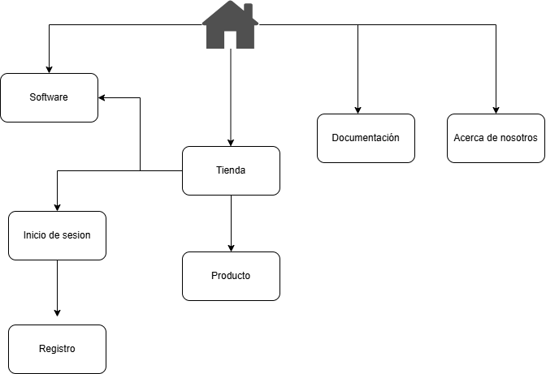

# Estructura Web

### ESTRUCTURA JERÁRQUICA

```text
Homepage
 ├── Software
 ├── Tienda
 │   ├── Inicio de sesión
 |   |   ├── Registro
 │   ├── Producto
 │   └── Software
 ├── Documentación
 └── Acerca de nosotros
```
<hr>

### Inventario

```text
| Página        |    Tipo   | Contenido Principal    | Prioridad |
|---------------|-----------|------------------------|-----------|
| Homepage      | Estática  | Presentación proucto   | Alta      |
| Tienda        | Categoría | Lista de Productos     | Alta      |
| Software      | Subpágina | Descarga de Programa   | Alta      |
| Productos     | Subpágina | Compra Productos       | Media     |
| Documentación | Subdominio| Guia de Usuario        | Media     |
| Acerca de     | Estática  | Información Extra      | Baja      |
| Inicio Sesión | Subpágina | Acceso de usuarios     | Alta      |
| Registro      | Subpágina | Acceso de usuarios     | Alta      |
```
<hr>

### Diagrama de navegación



<hr>

### Revisión de usabilidad

**1.** ¿Puede un usuario llegar a cualquier página en 3 clics máximo? **Hemos revisado las diferentes rutas que se pueden tomar y no supera los 3 clics desde cualquier sitio.**

**2.** ¿El menú principal tiene más de 7 opciones? **Actualmente tenemos solo 4 opciones en el menú principal.**

**3.** ¿Hay páginas "huérfanas" (sin enlaces que lleven a ellas)? **

**4.** ¿La navegación es intuitiva sin necesidad de explicaciones?

### Validación de usuarios


### Documentación Final
