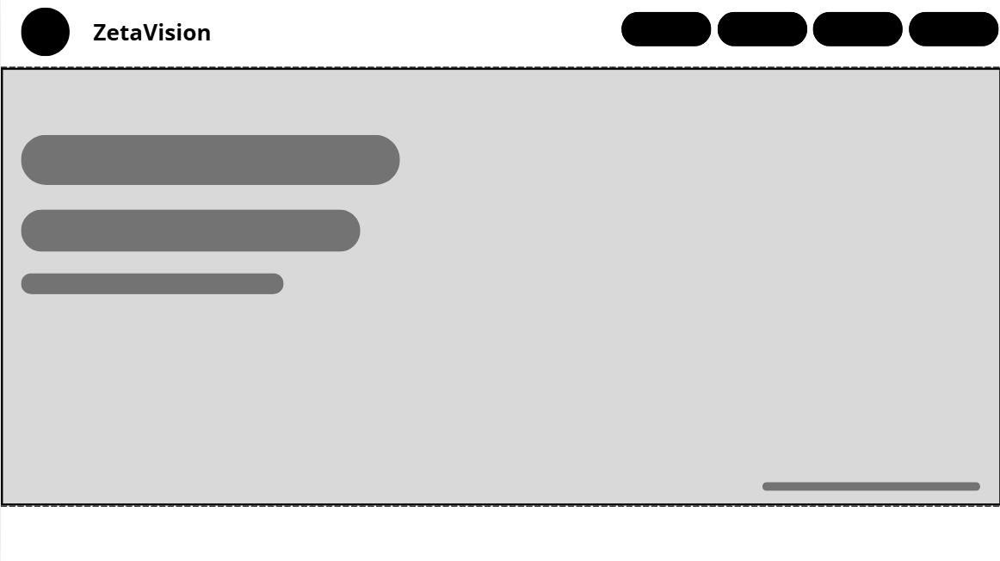
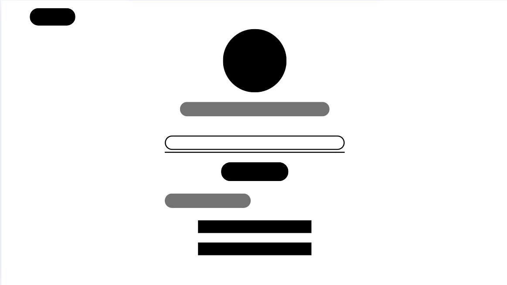
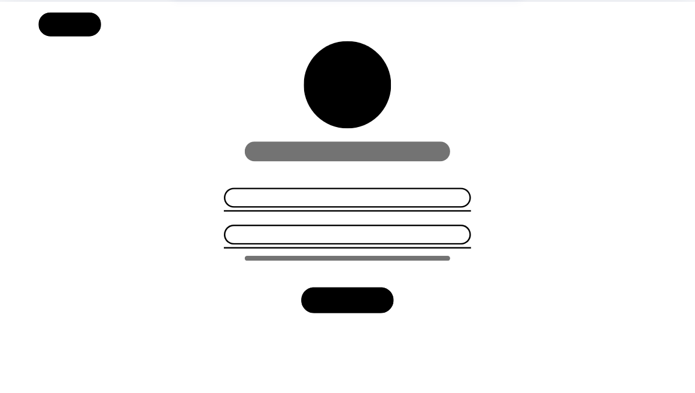
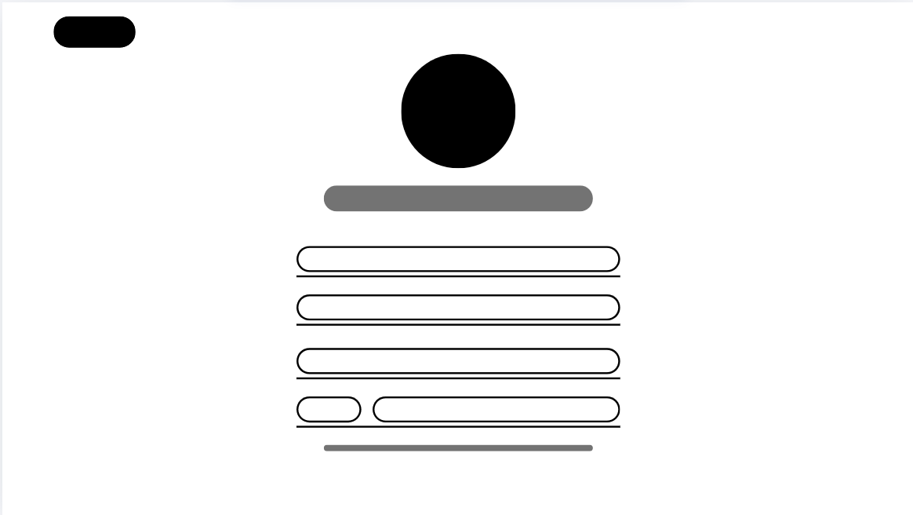
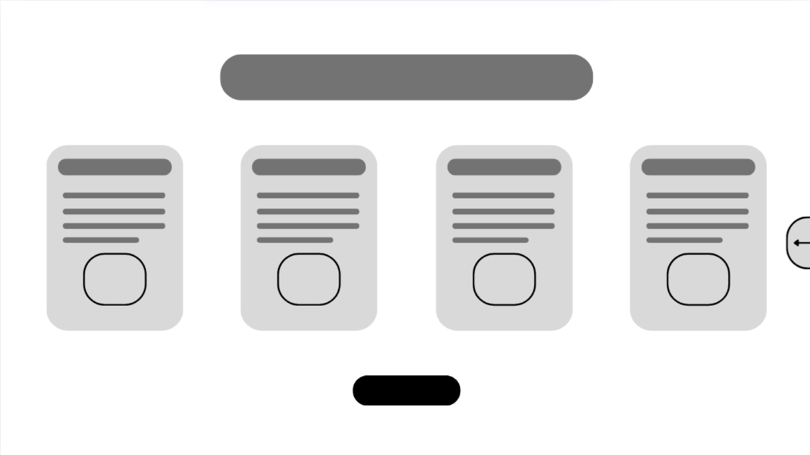
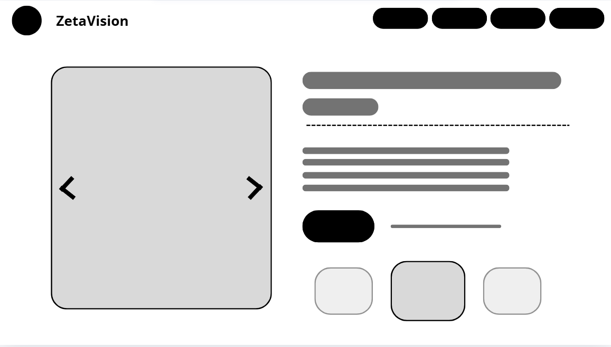

<h1>Wireframe ZetaVision</h1>

 

  
<b>Página Principal</b>

   
   
 

  

  
<b>Verificación de cuenta</b>

   
   
 

 

  
<b>Inicio Sesión</b>

   
   
 

 

  
<b>Registro</b>

   
   
 

 

  
<b>Caracteristicas</b>

   
   
 

  

  
<b>Página de compra</b>

   
   
 

